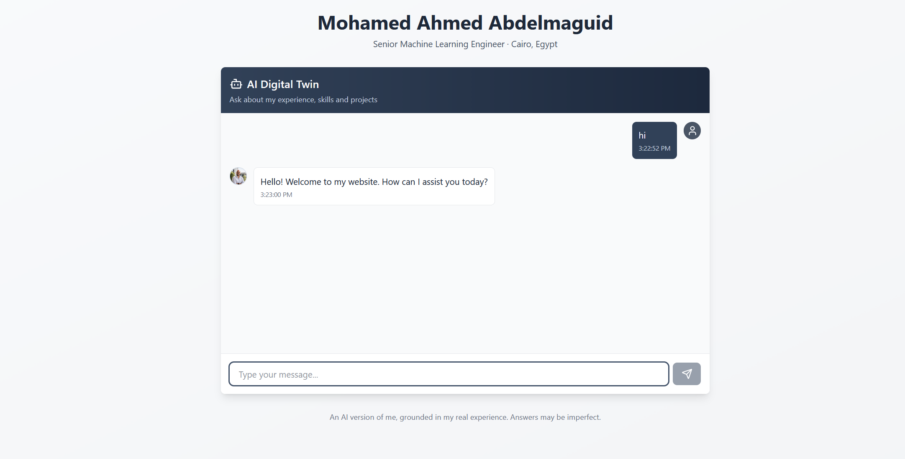

# AI Digital Twin

An LLM-powered "digital twin" that answers recruiter and client questions about my career in my own voice. Answers are grounded in my LinkedIn profile, a structured facts file and a style guide, with guardrails against invented facts and jailbreak attempts.

The whole stack is serverless on AWS, defined in Terraform, and deployed by GitHub Actions.



## Architecture

For a visual walkthrough of the deploy pipeline, request flow, environments, permissions and costs, open [docs/architecture.html](docs/architecture.html) in a browser.

```
Browser ──► CloudFront ──► S3 (Next.js static site)
   │
   └────► API Gateway (HTTP API, rate-limited) ──► Lambda (FastAPI + Mangum) ──► OpenAI
                                                      │
                                                      └──► S3 (per-session conversation memory)
```

| Layer          | Technology                                                       |
| -------------- | ---------------------------------------------------------------- |
| Frontend       | Next.js, TypeScript, Tailwind CSS (static export)                |
| Backend        | Python 3.12, FastAPI, Mangum, OpenAI (`gpt-4o-mini` by default)  |
| Infrastructure | Terraform: Lambda, API Gateway, S3, CloudFront, IAM, optional Route 53/ACM |
| State          | Terraform remote state in S3 with DynamoDB locking               |
| CI/CD          | GitHub Actions with AWS OIDC (no stored AWS keys)                |

## Repository layout

```
backend/            FastAPI app, Lambda handler and packaging script
  data/             Grounding data: facts.json, summary.txt, style.txt, linkedin.pdf
  server.py         API: /, /health, /chat, /conversation/{session_id}
  deploy.py         Builds lambda-deployment.zip inside the official Lambda Docker image
frontend/           Next.js chat UI (components/twin.tsx)
terraform/          All AWS infrastructure; one workspace per environment
scripts/            deploy / destroy scripts (.sh for Linux/CI, .ps1 for Windows)
.github/workflows/  deploy.yml and destroy.yml
```

## Run locally

Prerequisites: Python 3.12 with [uv](https://docs.astral.sh/uv/), Node.js 20, and an OpenAI API key.

**Backend** (http://localhost:8000):

```bash
cd backend
echo "OPENAI_API_KEY=sk-..." > .env
uv run uvicorn server:app --reload
```

Conversations are saved to `../memory` locally. Set `USE_S3=true` and `S3_BUCKET` to use S3 instead.

**Frontend** (http://localhost:3000):

```bash
cd frontend
npm install
npm run dev
```

The frontend calls `NEXT_PUBLIC_API_URL` and falls back to `http://localhost:8000` if it isn't set. To show your photo in the chat, add `frontend/public/avatar.png`.

## Deploy to AWS

### One-time setup

1. Create the Terraform state backend in your region: an S3 bucket named `twin-terraform-state-<ACCOUNT_ID>` and a DynamoDB table named `twin-terraform-locks` with partition key `LockID` (String).
2. Create an IAM role that GitHub Actions can assume through OIDC (trusting `token.actions.githubusercontent.com` for this repo) and that has permission to manage the resources above.
3. In GitHub, go to **Settings → Secrets and variables → Actions** and add these secrets:

   | Secret               | Value                                        |
   | -------------------- | -------------------------------------------- |
   | `AWS_ROLE_ARN`       | ARN of the OIDC role                         |
   | `AWS_ACCOUNT_ID`     | 12-digit AWS account ID                      |
   | `DEFAULT_AWS_REGION` | e.g. `eu-north-1`                            |
   | `OPENAI_API_KEY`     | OpenAI key (paste without a trailing newline) |

4. Create GitHub environments named `dev`, `test` and `prod`. You can add required reviewers to `prod` so its deploys need approval.

### CI/CD

- **Deploy:** every push to `main` deploys to `dev`. To deploy to `test` or `prod`, run the **Deploy Digital Twin** workflow manually from the Actions tab and pick the environment. The workflow builds the Lambda package, applies Terraform, builds the frontend, uploads it to S3 and invalidates the CloudFront cache.
- **Destroy:** run the **Destroy Environment** workflow manually. You must type the environment name to confirm.

### Deploy from your machine

The deploy script reads the OpenAI key from `TF_VAR_openai_api_key`, or from `backend/.env` if that variable isn't set.

```bash
./scripts/deploy.sh dev           # Linux / macOS
./scripts/destroy.sh dev
```

```powershell
.\scripts\deploy.ps1 -Environment dev     # Windows
.\scripts\destroy.ps1 -Environment dev
```

### Configuration

The defaults are in [terraform/terraform.tfvars](terraform/terraform.tfvars). For example, `openai_model`, `lambda_timeout`, the API throttle limits, and `use_custom_domain` / `root_domain`, which add an ACM certificate and Route 53 records. For prod-only overrides, create `terraform/prod.tfvars`. The API key is never stored in tfvars.

## Customising the twin

To change what the twin knows and how it sounds, edit the files in `backend/data/`:

- `facts.json`: structured facts (name, current role, location, contact details, specialties, experience, education)
- `summary.txt`: a free-form background summary
- `style.txt`: tone and writing-style guidance
- `linkedin.pdf`: your LinkedIn profile export

Then redeploy.
